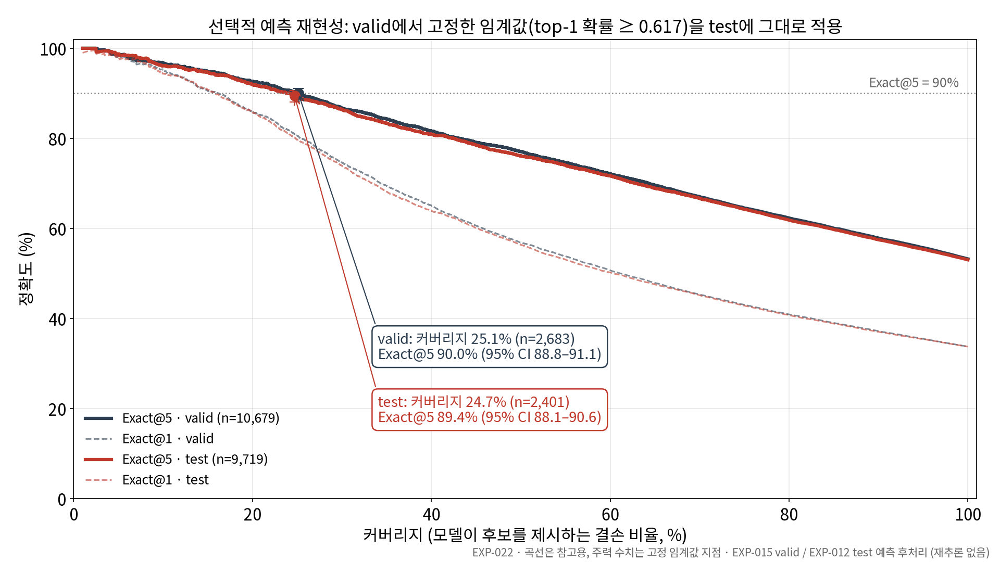

# 금석문 결손 한자 top-k 복원 보조 (Google × 아주대 AI 캡스톤)

[](https://github.com/sooyahh/epigraph-restoration/actions/workflows/tests.yml)

**Top-k candidate prediction for missing Hanja characters in Korean epigraph transcriptions.** I fine-tuned and evaluated the SillokBERT model for a team capstone that won an **Encouragement Award** at the 2nd Google × Ajou University AI Convergence Capstone Design Competition (Oct 2026, team project *Saegim*).

- Fine-tuning raised Exact@5 from **43.17% to 53.04%** on the same held-out test set (n = 9,719, split by inscription).
- A selective-prediction rule tuned only on validation data proposes candidates for about a quarter of gaps at **89.4% Exact@5 on test**, and leaves the rest to experts.

---

한국 금석문(비석·탁본) 판독문에서 **결손 한자(`□`)** 위치에 **top-k 후보**를 제시하는 프로젝트입니다.
완전 자동 복원이 아니라, 전문가·검수자의 판독을 **보조**하는 것이 목표입니다.

모델은 결손 자리를 `"[MASK]"`로 두고 **text-only MLM(마스킹 언어모델)** 으로 한자를 예측합니다.

## 개인 기여도 (AI 모델 담당)

이 프로젝트는 팀 캡스톤 과제이며, **sooyahh가 BERT 기반 결손 한자 예측 모델의 파인튜닝과 성능 평가를 단독 담당**했습니다. 아래의 zero-shot 및 fine-tuned SillokBERT 수치는 모두 **담당 BERT 모델 자체를 같은 인공 single-mask 테스트셋에서 평가한 결과**이며, 팀 전체 시스템의 통합 정확도를 의미하지 않습니다.

- SillokBERT 파인튜닝 및 zero-shot 대비 성능 비교 수행
- 동일한 test **n=9,719**에서 **Exact@5 43.17% → 53.04% (+9.87%p)** 확인
- Exact@k는 정답 한자가 상위 k개 후보에 포함되는 비율로, 실제 결손 판독의 정답률과는 구분

프론트엔드·백엔드 등 다른 팀원의 담당 영역을 개인 성과로 포함하지 않았습니다.

## 무엇을 하나요

- 입력: 결손(`□`) 또는 마스크가 표시된 금석문 판독문
- 출력: 각 마스크 위치의 한자 후보 top-k (+ 상대 점수)
- 정량 평가: 정답이 있는 **인공 single-mask** 데이터에서 `Exact@1 / Exact@5 / Exact@10`
- 실제 결손: gold가 없어 **정성 데모**로만 다룸 (인공 Exact@k와 동일시하지 않음)

## 결과

동일 **test n=9,719** 기준. 서빙·발표용 공식 비교 수치는 **EXP-012**입니다.

| 모델 | Exact@1 | Exact@5 | Exact@10 |
| --- | ---: | ---: | ---: |
| SillokBERT zero-shot (EXP-007) | 24.89% | 43.17% | 51.22% |
| **SillokBERT fine-tune (EXP-012)** | **33.75%** | **53.04%** | **60.47%** |

- 데이터: 인공 single-mask **66,537건** (train 46,139 / valid 10,679 / test 9,719, inscription 단위 split)
- 체크포인트는 valid loss로 선택했고, test로 다시 고르지 않았습니다. 수치는 저장된 예측 파일에서 다시 계산해 확인했습니다 ([`reports/exp012_metrics_reverify.json`](reports/exp012_metrics_reverify.json)).
- 이득은 고빈도 한자에 집중되며, 학습 데이터에 한 번만 나온 한자(hapax) 구간은 zero-shot 대비 하락했습니다 (EXP-013/014).

## 선택적 제안 (기권 규칙)

모든 결손에 후보를 내면 희귀 한자에서 틀린 제안이 섞입니다. 그래서 **모델의 top-1 softmax 값이 임계값 이상일 때만 후보를 제안**하고 나머지는 전문가에게 넘기는 규칙을 만들었습니다. 이 값은 보정된 신뢰확률이 아니므로, 임계값은 valid에서 경험적으로 정하고(EXP-020) test에서는 다시 찾지 않고 그대로 적용했습니다(EXP-022).



| split | 임계값 (top-1 softmax) | 제안 비율 | Exact@1 | Exact@5 | Exact@10 |
| --- | ---: | ---: | ---: | ---: | ---: |
| valid (EXP-020, 임계값 결정) | 0.617386 | 25.1% | 80.5% | 90.0% | 91.9% |
| **test (EXP-022, 고정 적용)** | 0.617386 | **24.7%** | **80.2%** | **89.4%** | **91.5%** |

- test와 valid의 차이는 지표별 0.3~0.6%p였고, 95% 신뢰구간이 모두 0을 포함해 통계적으로 유의하지 않았습니다 (p ≥ 0.49).
- 상세: [`reports/exp022/exp022_results.md`](reports/exp022/exp022_results.md), 빈도 구간별 분석은 [`reports/exp023/`](reports/exp023)

## 데이터 · 평가 원칙

- 판독문 원천: 국립문화유산연구원 한국금석문 종합영상정보시스템(NRICH)
- 실제 결손 `□`와 한글 치환 `◇`를 구분 (`gsm_preprocess_v4`)
- split은 **inscription 단위** (`seed=42`) — 동일 비문이 train/test에 섞이지 않음
- 체크포인트·HP 선택은 validation; test는 최종 비교에 제한적으로 사용
- 인공 마스크 성능 ≠ 실제 훼손 복원 능력

상세: [`docs/DATA_SCHEMA.md`](docs/DATA_SCHEMA.md), [`docs/DATA_PREPROCESSING_RULES.md`](docs/DATA_PREPROCESSING_RULES.md)

## 한계

- 인공 single-char 마스크만 정량 평가 (연속 결손 미포함)
- test–train n-gram overlap이 남아 정형구 효과가 성능에 섞일 수 있음
- tokenizer UNK 정답은 해당 vocab 모델이 직접 출력하기 어려움
- 학습 corpus는 1차 가공본이며, 전수 수동 검수를 거친 corpus는 아님
- 모델 가중치와 원천 데이터가 저장소에 없어, 학습·평가 수치는 이 저장소만으로 재실행할 수 없음

## 레포 구조

| 경로 | 내용 |
| --- | --- |
| `src/` | 전처리 · 학습 · 평가 · 추론 |
| `scripts/` | 분석 스크립트 (기권 규칙, 누수 감사, 빈도 구간 분석 등) |
| `tests/` | 단위 테스트 |
| `docs/` | 스키마 · 규칙 · 의사결정 · 실험 로그 |
| `docs/process/` | AI 도구 협업 운영 규칙 · 역할 · 프롬프트 템플릿 |
| `reports/` | 실험 리포트 · 그림 · 집계 결과 |
| `handoff/` | FE/BE 계약, FastAPI 추론 스텁, 모킹 fixture |
| `notebooks/` | EXP-012 · EXP-018 Colab 노트북 |

## 빠른 시작

### 의존성 · 테스트

```bash
pip install -r requirements.txt
python -m unittest discover -s tests
```

단위 테스트는 원천 데이터와 모델 가중치 없이 실행됩니다.

### FastAPI 추론 스텁 (`handoff/backend`)

```bash
cd handoff/backend
pip install -r requirements.txt

# 체크포인트 경로 (필수)
export MODEL_DIR=/path/to/checkpoint   # Windows: set MODEL_DIR=C:\path\to\checkpoint

uvicorn app:app --host 0.0.0.0 --port 8000
```

- `POST /predict` — `text`에 `"[MASK]"` **정확히 1개**, `top_k` 기본 10
  응답: `candidates[{ rank, char, score }]` (`score`는 softmax 값으로, 보정된 신뢰확률이 아님)
- `GET /health`
- UI만 먼저 붙이려면 `handoff/fixtures/predict_samples.json`으로 모킹

계약·응답 예시는 [`handoff/README.md`](handoff/README.md).

## 더 읽기

- [`docs/PROJECT_OVERVIEW.md`](docs/PROJECT_OVERVIEW.md) — 목표 · 진행 상태
- [`docs/EXPERIMENT_LOG.md`](docs/EXPERIMENT_LOG.md) — 실험 기록 (수치 근거)
- [`docs/DECISIONS.md`](docs/DECISIONS.md) — 채택/보류 결정
- [`docs/RISK_CHECKLIST.md`](docs/RISK_CHECKLIST.md) — 위험·대응
- [`docs/process/AI_COUNCIL.md`](docs/process/AI_COUNCIL.md) — 여러 AI 도구를 쓸 때의 역할 분담과 검증 규칙

## 공개용 사본 안내

- 이 저장소는 캡스톤 조직 저장소(비공개)의 `main`(2026-10-02)을 포트폴리오용으로 옮긴 것입니다. 이 저장소의 코드·문서·실험은 sooyahh가 Cursor 등 AI 코딩 도구와 함께 작성했습니다. 팀의 프론트엔드·백엔드 저장소는 포함하지 않습니다.
- 데이터 재배포를 피하려고 원본 XLS·가공 corpus·마스크 데이터셋과, 판독문이 들어간 대량 예측 CSV는 넣지 않았습니다. 데모·전문가 패널용 소량 예시(수십 건)만 남겼으며, 판독문의 저작권과 이용조건은 NRICH를 따릅니다.
- 모델 가중치와 조직 저장소의 커밋 이력은 옮기지 않았습니다. 실험 문서 일부에는 작업 당시의 경로·상태 표현이 남아 있습니다.

## License

코드는 [MIT](LICENSE)입니다. NRICH 판독문 예시와 모델 가중치에는 적용되지 않습니다.
