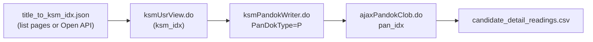

# NRICH detail collection pipeline

## Flow



## Endpoints

| Step | URL | Input | Output |
| --- | --- | --- | --- |
| List index | `/kor/ksmUsrList.do` | `pageindex` | `ksm_idx` + title key |
| Detail page | `/kor/ksmUsrView.do` | `ksm_idx` | pan_idx list (HTML) |
| Reader list | `/kor/ksmPandokWriter.do` | `ksm_idx`, `PanDokType=P` | `pan_idx`, reader |
| Full text | `/ajaxPandokClob.do` | `pan_idx` | `sol_pan_txt` (판독문 전문) |

## Validation (2026-07-03)

- `KSM_IDX=3`: ≥2 판독문 (김혜완, 『가평군 금석문집』 등)
- `KSM_IDX=5`: ≥1 판독문 (김은미)
- Truncation sample `KSM_IDX=2866` / 정병삼: XLS 9,782 chars vs detail 18,514 chars (+8,732)

## Commands

```bash
# Build/resume title index
python work/build_title_index.py

# Validate + sample collect
python -m src.data.collect_detail_readings --limit 25

# Full collect (slow; rate-limit aware)
python -m src.data.collect_detail_readings --full
```

Implementation: `src/nrich/detail_client.py`, `src/data/collect_detail_readings.py`.
