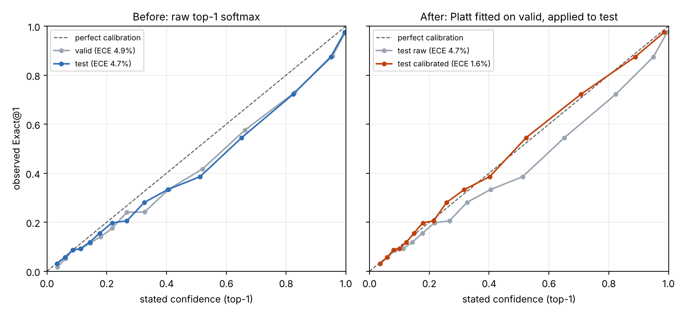

# EXP-034 — top-1 확신도 보정(calibration) 분석

- 생성: 2026-11-18T05:11:55+00:00
- 유형: 후처리 분석 (모델 로딩·재추론 없음)
- 입력: valid `reports/exp020/exp020_sample_confidence.csv` (n=10,679), test `reports/exp022/exp022_test_sample_confidence.csv` (n=9,719)
- 원칙: 보정기 선택은 valid 5-fold 교차검증 NLL로만 결정, valid 전체로 학습한 뒤 test에는 그대로 한 번 적용

## 1. 보정 전: 모델은 실제보다 자신 있게 말한다

| split | 평균 확신도 | 실제 Exact@1 | ECE (15 bins) | Brier |
|---|---:|---:|---:|---:|
| valid | 38.7% | 33.8% | 4.9% | 0.1370 |
| test | 38.4% | 33.7% | 4.7% | 0.1399 |

test 구간별 (확신도 10% 단위):

| 확신도 구간 | n | 평균 확신도 | 실제 Exact@1 | 차이 |
|---|---:|---:|---:|---:|
| 0.0–0.1 | 1970 | 6.1% | 5.7% | -0.3%p |
| 0.1–0.2 | 1995 | 14.7% | 12.9% | -1.8%p |
| 0.2–0.3 | 1296 | 24.8% | 20.0% | -4.8%p |
| 0.3–0.4 | 879 | 34.7% | 30.6% | -4.1%p |
| 0.4–0.5 | 602 | 44.8% | 33.4% | -11.4%p |
| 0.5–0.6 | 493 | 54.9% | 43.6% | -11.2%p |
| 0.6–0.7 | 412 | 64.7% | 51.7% | -13.0%p |
| 0.7–0.8 | 355 | 75.1% | 67.6% | -7.5%p |
| 0.8–0.9 | 423 | 85.3% | 74.5% | -10.8%p |
| 0.9–1.0 | 1294 | 97.3% | 92.5% | -4.8%p |

## 2. 보정기 선택 (valid만 사용)

| 보정기 | valid 5-fold CV NLL |
|---|---:|
| platt | 0.4210 ← 선택 |
| isotonic | 0.4227 |
| histogram | 0.4235 |
| (보정 안 함) | 0.4328 |

## 3. test 결과 (valid로 학습한 보정기를 그대로 적용)

| 방법 | 평균 확신도 | ECE (15 bins) | ECE (동일 개수 bins) | Brier | NLL |
|---|---:|---:|---:|---:|---:|
| 보정 안 함 | 38.4% | 4.7% | 4.7% | 0.1399 | 0.4405 |
| platt (선택) | 33.5% | 1.6% | 1.2% | 0.1363 | 0.4284 |
| isotonic | 33.4% | 1.0% | 1.0% | 0.1366 | 0.4328 |
| histogram | 33.5% | 0.9% | 1.2% | 0.1369 | 0.4305 |

- 선택한 보정기(platt)의 test ECE 변화: -2.88%p (bootstrap 95% CI -3.83 ~ -1.91%p, 1000회)
- test 실제 Exact@1은 33.7%이며, 보정 후 평균 확신도는 33.5%로 가까워졌다.

## 4. 기권 규칙과의 관계

- 보정은 점수의 순서를 바꾸지 않는 단조 변환이라, EXP-020/022의 기권 규칙이 고르는 표본(top-1 ≥ 0.617386)은 그대로다. 제안 비율과 정확도는 바뀌지 않는다.
- 바뀌는 것은 화면에 보여 줄 숫자다. 원래 점수 0.617는 보정 후 약 49.1%로 읽어야 한다.
- 즉 "모델 점수 62%"를 그대로 보여 주면 사용자는 실제보다 높게 믿게 된다. 보정값을 보여 주면 "이 후보가 맞을 확률"에 더 가까운 숫자를 줄 수 있다.

## 5. (보조) 상위 5개 후보 안에 정답이 있을 확률

- 상위 10개 후보의 확률 합(`topk_mass`)을 그대로 Exact@5 확률로 읽으면 test ECE 10.9%로 크게 어긋난다.
- valid로 학습한 Platt 보정을 적용하면 test ECE 2.3%가 된다.

## 6. 한계

- 저장된 예측에는 top-10 확률만 있어 전체 어휘 logit이 필요한 temperature scaling은 하지 않았다. Platt 보정은 top-1 점수 하나에 대한 2-파라미터 보정이다.
- 인공 single-mask 표본 기준이다. 실제 결손(정답 없음)에서의 보정 상태는 확인할 수 없다.
- valid(EXP-015)와 test(EXP-012) 예측은 같은 체크포인트(`exp012_sillokbert_gpu_best_valid_loss`)에서 나왔다.
